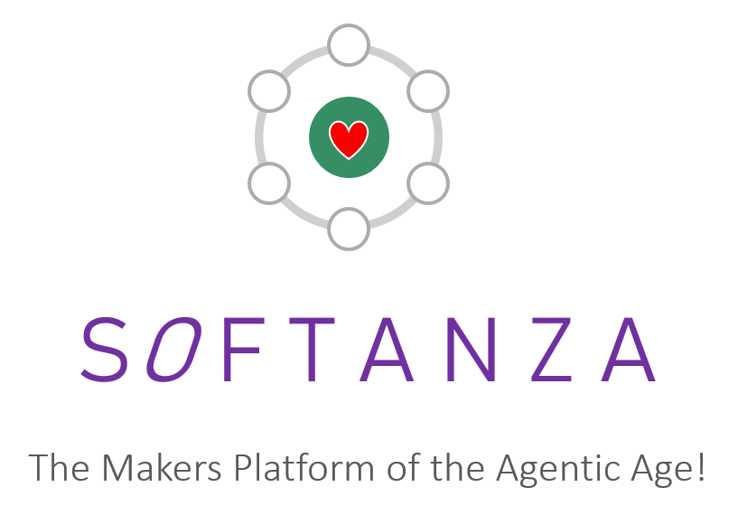
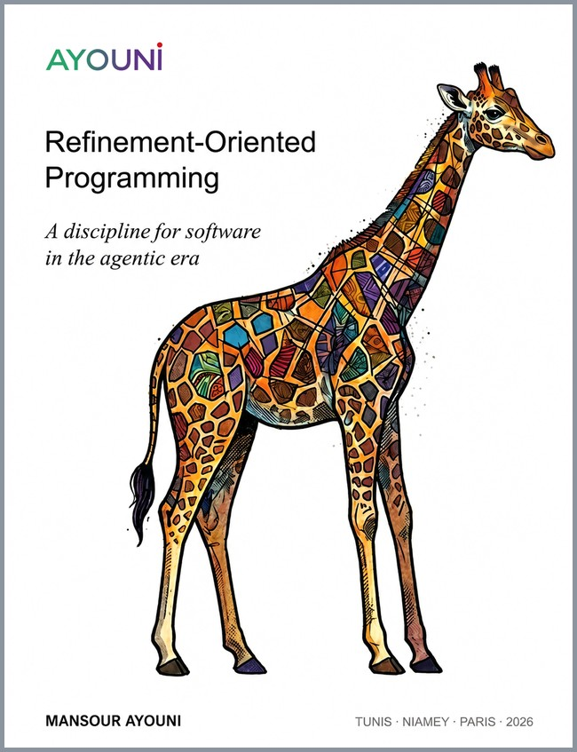

<p align="center">
  
</p>

# Softanza

**Declare what you know. A court keeps it. The AI model comes last.**

Softanza is a computational platform built around a single engine written in
[Zig](https://ziglang.org). One codebase covers text, exact numbers, tables,
graphs, maps, images, sound, neural networks and governed AI agents. This
repository, `stzlib`, is the library.

Softanza runs on **[Ring++](https://mayouni.github.io/ringpp/)**, a compiler and
virtual machine of its own. Ring++ keeps a Ring facet, so the legacy code
written in Ring keeps working until **Haro**, the Softanza project's programming
language made for the agentic era, is adopted. Ring itself is retired from the
project; [why Ring++ left Ring](https://mayouni.github.io/ringpp/why.html) gives
the technical and the governance reasons.

**Website: [mayouni.github.io/stzsite](https://mayouni.github.io/stzsite/index.html?lang=en)**
(also in [French](https://mayouni.github.io/stzsite/index.html?lang=fr))

## What it looks like

```
load "stzlib.ring"

? "sort:      " + @@( Q([ 3, 1, 2 ]).Sorted() )
? "upper:     " + StzStringQ("ring++ runs softanza").Uppercased()
? "words:     " + StzStringQ("one two three").NumberOfWords()
```

```
sort:      [ 1, 2, 3 ]
upper:     RING++ RUNS SOFTANZA
words:     3
```

Some of what the engine does, and the website runs the rest:

- It counts characters, not bytes. The Arabic word for "peace" is 8 bytes and
  4 characters; the engine answers 4 and names the script.
- Integers stay exact at any size: `Q(2).Power(64)` is `18446744073709551616`.
- A string can list its own methods and answer "how do I remove duplicates
  from a list?" from the library's own documentation.

## The idea: declare, then govern

- **Declare, then govern.** The world is declared in a language made for it, a
  court judges the declaration at run time, and nothing is taken on trust.
- **Agents that cannot do harm.** An agent proposes; it does not commit. It
  rehearses every write against a virtual twin of the world, and its only
  output is a readable plan. The court checks the plan for scope, capability
  and reversibility, and only a governed actor commits. The website cites
  thirty-eight guarantees, each tied to a guard that runs.
- **Proof before promise.** Every runnable code block on the website was run
  before it was published, and every claim points to the file that proves it.

In one demonstration, an agent proposed 610 file deletions in a course folder.
An AI helper tried to commit the plan and was refused, because it lacked the
`effectful` capability. The folder still held all 610 files. See
[Safe agents](https://mayouni.github.io/stzsite/en/agentic.html).

## How it is built

Softanza was written by hand. The GitHub history shows it: more than 300,000
lines of code and tens of thousands of test samples, written over about five
years, before AI coding tools existed.

AI came in two steps. In late 2025 the author started using AI by pasting its
results into the code himself. In 2026 he moved to Claude Code Desktop, and
Softanza became an AI-first product: Claude Code now writes all of the Zig code
and all of the Ring++ code. Mansour Ayouni's work changed with it: he no longer
writes the code, he governs the refinements the AI makes to it. That way of
working is described in the narration
[Refinement-Centered Programming](https://mayouni.github.io/stzsite/en/narrations/stzpolycode-refinement-centered-programming.html),
on the [refinement page](https://mayouni.github.io/stzsite/en/refinement.html),
and in the second book below.

## The books

<table>
  <tr>
    <td align="center" valign="top" width="50%">
      <a href="https://mayouni.github.io/ayouni/books/softanza/en/">
        
      </a>
      <br><br>
      <b>Softanza</b><br>
      <i>The Governed Software Platform of the AI Age</i><br>
      The long form of the ideas on this page: why the world is declared, how a
      court keeps it, and why the AI model comes last.<br><br>
      <a href="https://mayouni.github.io/ayouni/books/softanza/en/">Read it online</a>
    </td>
    <td align="center" valign="top" width="50%">
      <a href="https://mayouni.github.io/ayouni/books/refinement/en/">
        
      </a>
      <br><br>
      <b>Refinement-Oriented Programming</b><br>
      <i>A discipline for software in the agentic era</i><br>
      How software is built when an AI writes the code and a person governs its
      refinements, the way Softanza itself is built now.<br><br>
      <a href="https://mayouni.github.io/ayouni/books/refinement/en/">Read it online</a>
    </td>
  </tr>
</table>

Both are by Mansour Ayouni (2026).

## Sibling projects

Softanza has sibling projects that complement it. Three of them are renamed when
Haro is adopted.

| Project | What it is | Becomes |
|---|---|---|
| [RingServ](https://mayouni.github.io/ringserv/) | A single-file server for applications and web services: a web server, a SQL database and a JavaScript engine in one binary. | HaroServ |
| [RingScript](https://mayouni.github.io/ringscript/) | Frontend scripting that runs the compiler and virtual machine in the browser, as WebAssembly, so page logic is not written in JavaScript. | HaroScript |
| MicroRing | A private repository for now. | MicroHaro |
| [Harobanda](https://mayouni.github.io/harobanda/index.html) | A sovereign operating system, built on proven Linux, for governing AI agents and for critical work that must keep running under its owner's control. Open source, MIT. | |

## The 28 areas

One engine, organised in areas:

| | |
|---|---|
| **Core data and language** | strings, pattern matching, collections and objects, numeric and optimization, tables and data |
| **Language and intelligence** | internationalization, NLP and linguistics, the neural tier, agents and conversation |
| **Visual and spatial** | graphics, geo and cartography, diagrams and graphs, GPU, GUI and reactive interfaces, statistics and data-viz |
| **Systems and runtime** | system programming, concurrency and distribution, web and app server, performance, metaprogramming and code rules |
| **I/O, formats, media** | files and formats (JSON, CSV, XML), binary formats, security and governance, foreign code, sound |
| **Cross-cutting** | test and quality system, documentation system, governance doctrine |

Each area is described, with a worked picture, on the
[areas page](https://mayouni.github.io/stzsite/en/areas.html).

## Layers

| Layer | State |
|---|---|
| **Engine (Zig)** | The core. A C interface lets other languages and machines share it. |
| **[Ring++](https://mayouni.github.io/ringpp/)** | A compiler and virtual machine of its own. It runs Softanza today, and its Ring facet keeps the legacy code working. |
| **Haro** | The programming language of the Softanza project, made for the agentic era. Not available yet; its charter is a draft. |

## Getting started

Softanza runs on Ring++, which ships as one binary with no other install.

1. Download the package for your platform from the
   [latest Ring++ release](https://github.com/mayouni/ringpp/releases/latest):
   `ringpp-win64.zip` for Windows, `ringpp-linux-x64.tar.gz` for Linux.
2. Unpack it, save the example above as `prog.ring`, and run it with the
   `rnxc` binary:

```bash
ringpp-win64\bin\rnxc.exe prog.ring
```

The first run compiles the library's files, which takes about ten seconds; later
runs start from the compiled image in about a tenth of a second. The full steps
are on the [Ring++ start page](https://mayouni.github.io/ringpp/start.html), and
the walk-through of a first application is on the
[Softanza website](https://mayouni.github.io/stzsite/en/start.html).

To read or change the library itself, clone this repository:

```bash
git clone https://github.com/mayouni/stzlib.git
```

## Learn and look things up

| | |
|---|---|
| [Learn](https://mayouni.github.io/stzsite/en/learn.html) and the [interactive course](https://mayouni.github.io/stzsite/en/book.html) | the way of thinking, step by step |
| [How-to](https://mayouni.github.io/stzsite/en/howto.html) | single tasks, such as removing duplicates |
| [Reference](https://mayouni.github.io/stzsite/en/reference.html) and [Docs](https://mayouni.github.io/stzsite/en/docs.html) | exact method behaviour |
| [Architecture](https://mayouni.github.io/stzsite/en/architecture.html) | how the engine and Ring++ fit together |
| [The Softanza book](https://mayouni.github.io/ayouni/books/softanza/en/) | the long form |
| [What is proven](https://mayouni.github.io/stzsite/en/proven.html) | claims, each tied to the file that proves it |

## In this repository

```
libraries/stzlib/
  stzLib.ring     load this to use the library
  base/           the library: classes, tests, education material
  engine/         the Zig engine
  cli/            the stz command-line tool (Zig)
  tools/          the test runner
```

## Numbers

Counted on 1 October 2026, from the website's
[platform page](https://mayouni.github.io/stzsite/en/platform.html): 28 areas,
about 179,000 lines of Zig in the engine, about 531,000 lines of library code,
501 scenario guards, and 575 classes with 18,561 methods, each explained by the
library itself. They move as the code does; the website carries the current count.

## Issues and security

Questions and defect reports go to the
[issue tracker](https://github.com/mayouni/stzlib/issues). Report security
flaws privately, as described in [SECURITY.md](SECURITY.md).

## Licence

Code: [MIT](LICENSE), © 2020-2026 Mansour Ayouni. The books have their own
licence, linked from the website.

The website text was written with an AI assistant under the author's direction.
The code and the figures come from this repository.
